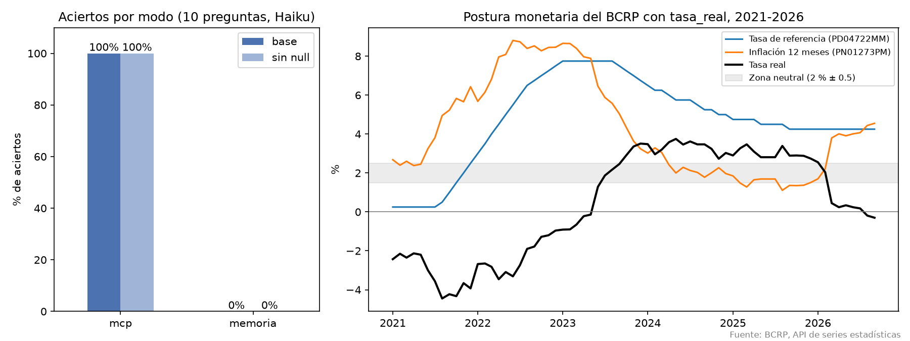

# Informe · Un MCP del BCRP que mide la postura monetaria

Servidor MCP con FastMCP 4 sobre las 17,167 series del BCRP: `buscar_series`, `serie`, `resumen` y una herramienta
propia, **`tasa_real`**, que cruza la tasa de referencia (PD04722MM) con la inflación a 12 meses de Lima (PN01273PM)
y aproxima, mes a mes, si la postura monetaria fue relativamente restrictiva, neutral o expansiva. Además trae el recurso
`bcrp://serie/{codigo}` y los prompts `postura_monetaria(desde, hasta)` e `informe(tema)`.

`uv run pytest -q` → **8 passed**. `test_server.py` no se modificó.

## 1. Resultados de la evaluación

`uv run evaluar.py --paralelo 2`, 10 preguntas, modelo Haiku (`resultados.csv`, copia en `resultados_base.csv`).

| Modo | Acierta | Se equivoca | No sabe | Segundos promedio |
|---|---|---|---|---|
| Memoria | 0 | 1 | 9 | 5.2 |
| MCP | **10** | 0 | 0 | 10.2 |

**Experimento extra (sin salida fácil):** `uv run evaluar.py --paralelo 2 --sin-null --salida resultados_sin_null.csv`
quita de la instrucción la frase «Si no puedes saberlo con certeza, pon valor null: no estimes.».

| Modo | Acierta | Se equivoca | No sabe | Segundos promedio |
|---|---|---|---|---|
| Memoria sin «null» | 0 | 1 | 9 | 5.4 |
| MCP sin «null» | **10** | 0 | 0 | 9.5 |

## 2. Qué falló cada modo y por qué

- **Memoria:** el conocimiento de Haiku llega hasta junio de 2026, así que en 9 de 10 preguntas dijo que no sabía, aun
  sin permiso explícito para responder null. La única cifra que se atrevió a dar fue la tasa de referencia de mayo de
  2024, y la dio mal las dos veces: **6.75 %** en la base y **6.25 %** sin «null», cuando la oficial es **5.75 %**. En
  la columna `fuente` lo admite: «Estimación de memoria, no verificada». Ese es el riesgo: cuando inventa, la cifra
  suena plausible y está equivocada.
- **MCP:** acertó las 10, y en cada una citó el código de la serie, el periodo y la URL de la API. En
  `tasa_real_set26` usó nuestra herramienta propia y devolvió −0.30 = 4.25 − 4.55 con las dos URLs de origen. Tarda
  el doble que la memoria (unos 10 s) porque busca el código y luego pide los datos.

## 3. Nuestras dos preguntas y las cifras comprobadas a mano

| id | Pregunta | Verdad | Dónde se comprobó |
|---|---|---|---|
| `referencia_may24` | Tasa de referencia del BCRP en mayo de 2024 | 5.75 % | [Tabla PD04722MM](https://estadisticas.bcrp.gob.pe/estadisticas/series/mensuales/resultados/PD04722MM/html/2024-1/2026-9/), fila May24 |
| `tasa_real_set26` | Tasa real ex post en setiembre de 2026 (referencia − inflación 12 meses) | −0.30 p.p. | [PD04722MM](https://estadisticas.bcrp.gob.pe/estadisticas/series/mensuales/resultados/PD04722MM/html/2024-1/2026-9/), Sep26 = 4.25, y [PN01273PM](https://estadisticas.bcrp.gob.pe/estadisticas/series/mensuales/resultados/PN01273PM/html/2026-1/2026-9/), Sep26 = 4.55 |

Capturas de la web del BCRP: [`capturas/05_web_bcrp_referencia.png`](capturas/05_web_bcrp_referencia.png) y
[`capturas/06_web_bcrp_inflacion.png`](capturas/06_web_bcrp_inflacion.png).

## 4. Qué dice la herramienta propia (2021-01 a 2026-09)

| Postura | Desde | Hasta | Meses |
|---|---|---|---|
| Expansiva | 2021-01 | 2023-06 | 30 |
| Neutral | 2023-07 | 2023-09 | 3 |
| Restrictiva | 2023-10 | 2026-01 | 28 |
| Neutral | 2026-02 | 2026-02 | 1 |
| Expansiva | 2026-03 | 2026-09 | 7 |

La tasa real fue negativa en 31 meses. El mínimo fue −4.45 % (2021-08) y el máximo 3.75 % (2024-05). En 2026 el BCRP
mantuvo la tasa en 4.25 %, pero la inflación subió hasta 4.55 %, y la postura pasó a expansiva sin que el BCRP moviera
la tasa. Supuestos: tasa real **ex post** (con la inflación observada, no con las expectativas) y tasa neutral de 2 %,
que es un parámetro de la herramienta.

En Claude Code se probaron las tres primitivas: la pregunta «¿fue restrictiva o expansiva en 2024?» hizo que Claude
llamara a `tasa_real` por su cuenta; `@bcrp:bcrp://serie/PD04722MM` devolvió la ficha (datos desde enero de 2004);
y `/mcp__bcrp__postura_monetaria 2021-01 2026-09` generó la tabla de arriba con sus fuentes. Al probar el prompt,
Claude marcó como sospechoso que la inflación saliera 1.69 % tres meses seguidos (mayo a julio de 2025). Lo
revisamos en la API: los valores son 1.6867, 1.6937 y 1.6888, distintos, y solo coinciden al redondearlos.

## 5. Cambios a `evaluar.py`

- `encoding="utf-8"` en `subprocess.run`: en Windows la salida de `claude -p` se leía como cp1252 y la corrida se caía
  con las tildes.
- Las opciones `--sin-null` y `--salida`, para repetir el experimento sin editar el archivo.

## 6. Conclusión

Sin herramientas, Haiku no conoce cifras recientes, y cuando se anima a dar una, se equivoca: 0 de 10 aciertos contra
10 de 10 con el MCP. Vale la pena construir un MCP cuando las preguntas se repiten sobre una misma fuente oficial,
cuando la respuesta exige un cálculo (como la tasa real, que combina dos series) y cuando cada cifra tiene que poder
rastrearse hasta su URL. Para una consulta aislada, sobre algo que se publica en noticias, basta con la búsqueda web:
según la medición del profesor acierta casi todo, aunque tarda unas tres veces más y no siempre encuentra la página
correcta.
